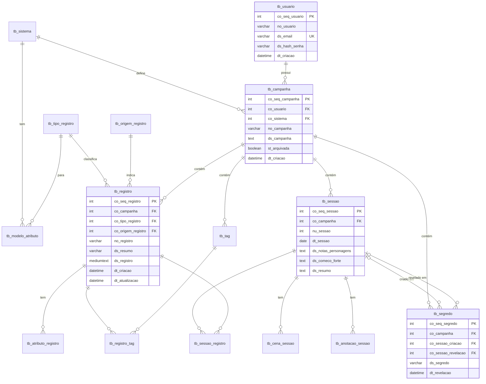

# Modelo de dados do MVP (fase 1)

Vem da seção 7 do [design do MVP](design/mvp.md). O script é o `database/01_criar_tabelas.sql`.

## Tabelas

| Tabela | Papel |
| --- | --- |
| `tb_sistema` | Domínio: 1 = D&D 5e (2024), 2 = Daggerheart. |
| `tb_tipo_registro` | Domínio: 1 NPC, 2 PJ, 3 Criatura, 4 Local, 5 Facção, 6 Item, 7 Missão. |
| `tb_origem_registro` | Domínio: 1 Criado, 2 Improvisado, 3 Importado (fases 2 e 3). |
| `tb_modelo_atributo` | Campos que o formulário mostra para cada tipo em cada sistema (por exemplo, "CA" para Criatura no D&D). Só guia o formulário: os valores ficam em `tb_atributo_registro`. |
| `tb_usuario` | Conta do mestre. O e-mail é guardado em minúsculas, e a senha só como hash. |
| `tb_campanha` | Campanha de um usuário, ligada a um sistema que não muda depois de criada. |
| `tb_registro` | Uma entrada do caderno (NPC, local, criatura…), com resumo de uma linha e descrição longa. |
| `tb_atributo_registro` | Pares chave/valor do registro: os do modelo + os livres, em ordem. |
| `tb_tag` | Tags da campanha, sem repetição dentro dela. |
| `tb_registro_tag` | Liga registros e tags (N:N). |
| `tb_sessao` | Sessão numerada da campanha, com os passos 1 (notas sobre os personagens) e 2 (começo forte) e o resumo pós-sessão. |
| `tb_cena_sessao` | Passo 3: cenas em ordem. |
| `tb_segredo` | Passo 4: pertence à **campanha**. Fica pendente enquanto `co_sessao_revelacao` for nulo, por isso aparece em todas as sessões até ser revelado. |
| `tb_sessao_registro` | Passos 5 a 8: locais, NPCs, criaturas e itens ligados à sessão. |
| `tb_anotacao_sessao` | Anotações com horário, feitas durante a sessão. |
| `tb_imagem_registro` | Imagens (mapas) anexadas a um registro, com título, tipo detectado pelos bytes, tamanho, ordem e o conteúdo em `bi_conteudo` (MEDIUMBLOB, até 15 MB). Script `05_imagens.sql`. Some com o registro (CASCADE). |

## Exclusões

- Excluir **usuário** → apaga as campanhas dele, e por cascata todo o resto.
- Excluir **campanha** → apaga os registros, as tags, as sessões e os segredos dela.
- Excluir **registro** → apaga os atributos, os vínculos com tags e os vínculos com sessões.
- Excluir **sessão** → apaga as cenas, as anotações e os vínculos. Nos segredos, `co_sessao_criacao` e `co_sessao_revelacao` viram nulos, então um segredo revelado nela volta a ficar pendente.
- As tabelas de domínio não são excluídas pela aplicação (FK padrão, que bloqueia a exclusão).
